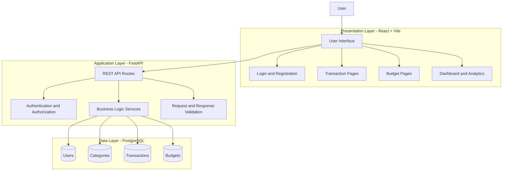
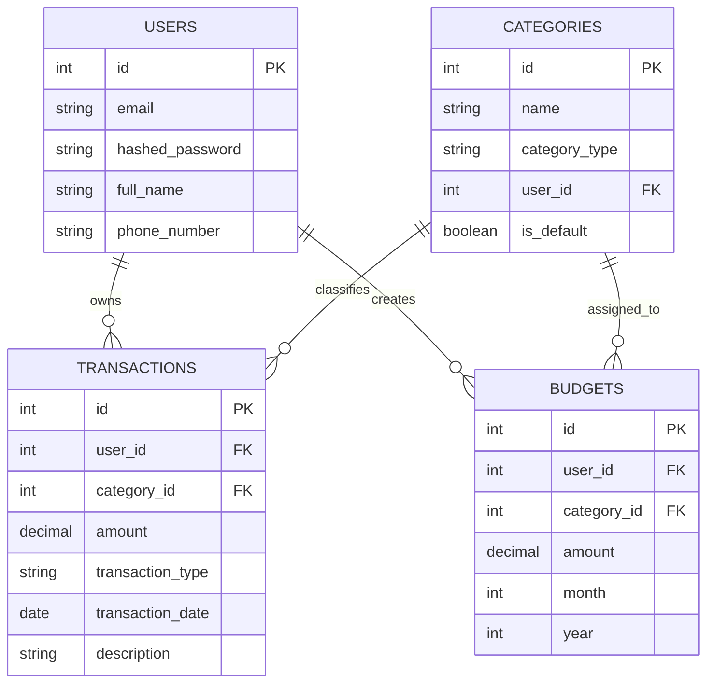
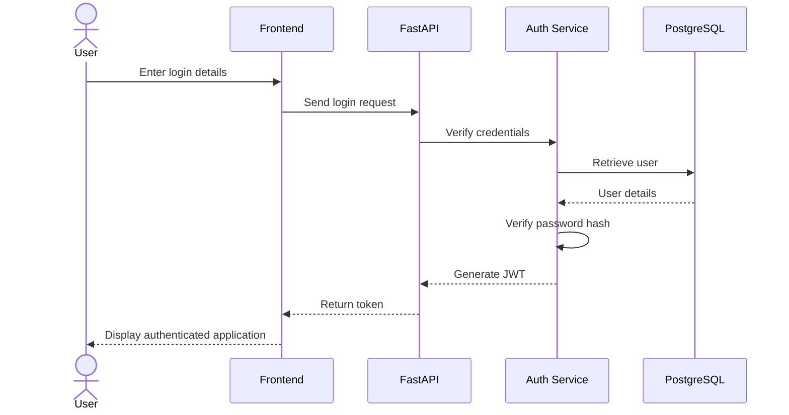
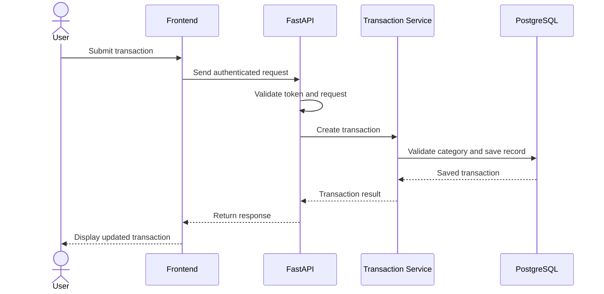
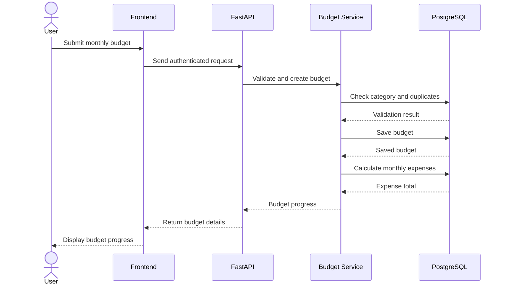

# Software Design Document (SDD)

## FinPilot – Smart Personal Finance & Expense Tracker with Budget Insights

**Version:** 1.0  
**Date:** 18 November 2026  
**SDLC Model:** Incremental Model

---

## 1. Introduction

### 1.1 Purpose

This document describes the software architecture, module design, database design, interfaces, and interactions of FinPilot.

It serves as a technical reference for developers, testers, and project evaluators.

### 1.2 Scope

FinPilot is a web-based personal finance management application. It enables users to manage income and expenses, organize transactions, create monthly budgets, and monitor spending.

The system uses a React frontend, a FastAPI backend, and a PostgreSQL database.

### 1.3 Design Goals

- Maintain a modular and understandable codebase.
- Separate presentation, business logic, and data access.
- Protect users' financial information.
- Support reliable transaction and budget operations.
- Enable independent testing of application modules.
- Allow new features to be added incrementally.

---

## 2. Architectural Design

### 2.1 Architecture Overview

FinPilot follows a three-layer client-server architecture.

1. Presentation Layer
2. Application Layer
3. Data Layer

### 2.2 Architecture Diagram

### 2.3 Architectural Components

**Presentation Layer**

The frontend is developed using React and Vite. It is responsible for rendering pages, collecting user input, displaying validation messages, and communicating with backend APIs.

**Application Layer**

The backend is developed using FastAPI. It handles HTTP requests, authentication, validation, business rules, and database operations.

**Data Layer**

PostgreSQL stores persistent user and financial information. SQLAlchemy provides object-relational mapping, while Alembic manages database schema migrations.

---

## 3. Module Design

### 3.1 Authentication Module

**Purpose:** Manage user registration and login.

Responsibilities:

- Accept registration details.
- Validate user credentials.
- Hash passwords using Argon2.
- Authenticate users.
- Issue JWT access tokens.
- Protect authenticated routes.

### 3.2 User Profile Module

**Purpose:** Manage individual user information.

Responsibilities:

- Retrieve the authenticated user's profile.
- Update supported profile fields.
- Ensure that users can only access their own profile.

### 3.3 Transaction Management Module

**Purpose:** Maintain financial transactions.

Responsibilities:

- Create income and expense records.
- Retrieve user transactions.
- Update transaction details.
- Delete transactions.
- Validate transaction ownership and associated categories.

### 3.4 Category Module

**Purpose:** Organize transactions.

Responsibilities:

- Provide categories for financial records.
- Distinguish income and expense categories.
- Validate category references.

### 3.5 Budget Management Module

**Purpose:** Manage monthly spending limits.

Responsibilities:

- Create monthly budgets.
- Retrieve user budgets.
- Update and delete budgets.
- Validate expense categories.
- Prevent duplicate budgets for the same user, category, month, and year.
- Calculate spending progress.

### 3.6 Dashboard and Analytics Module

**Purpose:** Present an overview of personal financial activity.

Planned responsibilities:

- Display income and expense summaries.
- Present budget information.
- Visualize spending patterns.
- Show relevant financial statistics.

The exact functionality depends on the final frontend and backend implementation.

### 3.7 Export and Insights Module

**Purpose:** Provide additional financial information.

Potential responsibilities:

- Generate CSV exports.
- Identify spending patterns.
- Provide budget-related insights.

These functions must be verified against the final implementation before being marked complete.

---

## 4. Database Design

### 4.1 Database Overview

FinPilot uses PostgreSQL as its relational database.

The main entities are:

- User
- Category
- Transaction
- Budget

### 4.2 Entity Relationship Diagram

**Note:** The diagram represents the logical data model. Confirm exact column names and types against the SQLAlchemy models before final submission.

### 4.3 Entity Descriptions

**User**

Stores account credentials and profile information. Passwords are stored as secure hashes.

**Category**

Stores categories used to classify income and expense transactions. Categories may be system defaults or user-specific.

**Transaction**

Stores individual income and expense records, including amount, category, date, and description.

**Budget**

Stores monthly spending limits associated with a user and an expense category.

### 4.4 Data Integrity

- Primary keys uniquely identify records.
- Foreign keys maintain relationships between entities.
- Budget amounts must be positive.
- Budget month values must be within the valid calendar range.
- Duplicate monthly budgets for the same user and category are prevented.
- User ownership is checked before accessing private records.

---

## 5. Interface Design

### 5.1 Frontend-to-Backend Interface

The frontend communicates with FastAPI through REST APIs.

Requests and responses use JSON for structured data exchange.

### 5.2 Authentication Interface

The frontend submits user credentials to the authentication endpoints.

After successful authentication, the returned JWT is used when accessing protected endpoints.

### 5.3 Transaction Interface

The frontend sends transaction details to the backend. The backend validates the data, applies business rules, and stores the record in PostgreSQL.

### 5.4 Budget Interface

The frontend submits budget information. The backend validates the category and amount, creates or updates the budget, and calculates budget progress from relevant expense transactions.

---

## 6. API Design

The following table describes the main API groups. Confirm exact paths and HTTP methods from the final FastAPI application.

| API Group | Purpose |
|---|---|
| Authentication APIs | Registration, login and current-user access |
| Profile APIs | Retrieve and update user profile |
| Transaction APIs | Transaction CRUD operations |
| Budget APIs | Budget CRUD and spending progress |
| Category APIs | Category retrieval and validation |

### 6.1 Budget API Design

The implemented budget API includes operations for:

- Creating budgets.
- Listing budgets.
- Retrieving an individual budget.
- Updating budgets.
- Deleting budgets.

The budget API uses authentication dependencies to identify the current user.

---

## 7. Security Design

### 7.1 Password Security

Passwords are hashed using Argon2 before being stored.

### 7.2 Authentication

JWT tokens are used to authenticate users when accessing protected endpoints.

### 7.3 Authorization

The backend verifies ownership of user-specific records before allowing access or modification.

### 7.4 Input Validation

Pydantic schemas validate incoming API request data.

### 7.5 Database Security

Database credentials are supplied through environment configuration rather than hardcoded in application source code.

---

## 8. Sequence Diagrams

### 8.1 User Login

### 8.2 Create Transaction

### 8.3 Create and Monitor Budget

---

## 9. Testing Design

FinPilot uses automated backend testing with Pytest and HTTPX.

### 9.1 Unit Testing

Unit tests verify individual functions and components independently, including applicable business logic and validation.

### 9.2 Integration Testing

Integration tests verify interactions between API routes, authentication, services, and database operations.

### 9.3 Budget Integration Testing

Budget integration tests cover:

- Budget creation.
- Duplicate budget prevention.
- Category validation.
- Budget listing.
- Spending calculations.
- Budget updates.
- Budget deletion.
- User-level access restrictions.
- Authentication requirements.

### 9.4 Current Backend Test Result

The backend test suite has produced the following result after the budget module was merged:

| Metric | Result |
|---|---:|
| Total tests passed | 60 |
| Failed tests | 0 |
| Execution time | 27.48 seconds |
| Warnings | 1 deprecation warning |

This is the observed result of the current test run, not a guarantee of frontend end-to-end coverage.

---

## 10. Deployment and Configuration Design

### 10.1 Development Environment

The backend runs using Python and FastAPI. The frontend runs using the Vite development server.

PostgreSQL provides database services.

### 10.2 Database Migrations

Alembic manages database schema changes. Migrations should be applied before running the application against a newly configured database.

### 10.3 Environment Configuration

Sensitive configuration values, including database credentials and authentication secrets, should be provided through environment variables.

---

## 11. Software Development Life Cycle

### 11.1 Selected Model

FinPilot follows the **Incremental Model**.

### 11.2 Development Increments

| Increment | Deliverable |
|---|---|
| 1 | Project foundation and database |
| 2 | Authentication and user profile |
| 3 | Transaction management |
| 4 | Budget management |
| 5 | Frontend integration and remaining features |
| 6 | Testing, documentation and final integration |

Each increment adds functionality to the existing application and is verified through appropriate testing.

---

## 12. Conclusion

The FinPilot design separates the user interface, application logic, and persistent data storage into distinct layers.

Its modular structure supports maintainability, testing, and incremental feature development. The architecture provides a foundation for secure personal finance management and future enhancements.

---

**End of Software Design Document**
