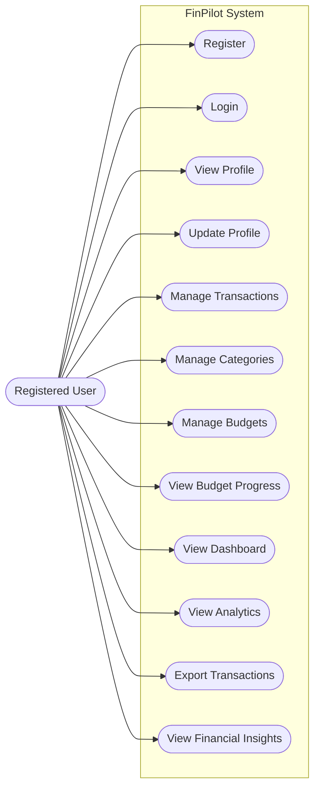
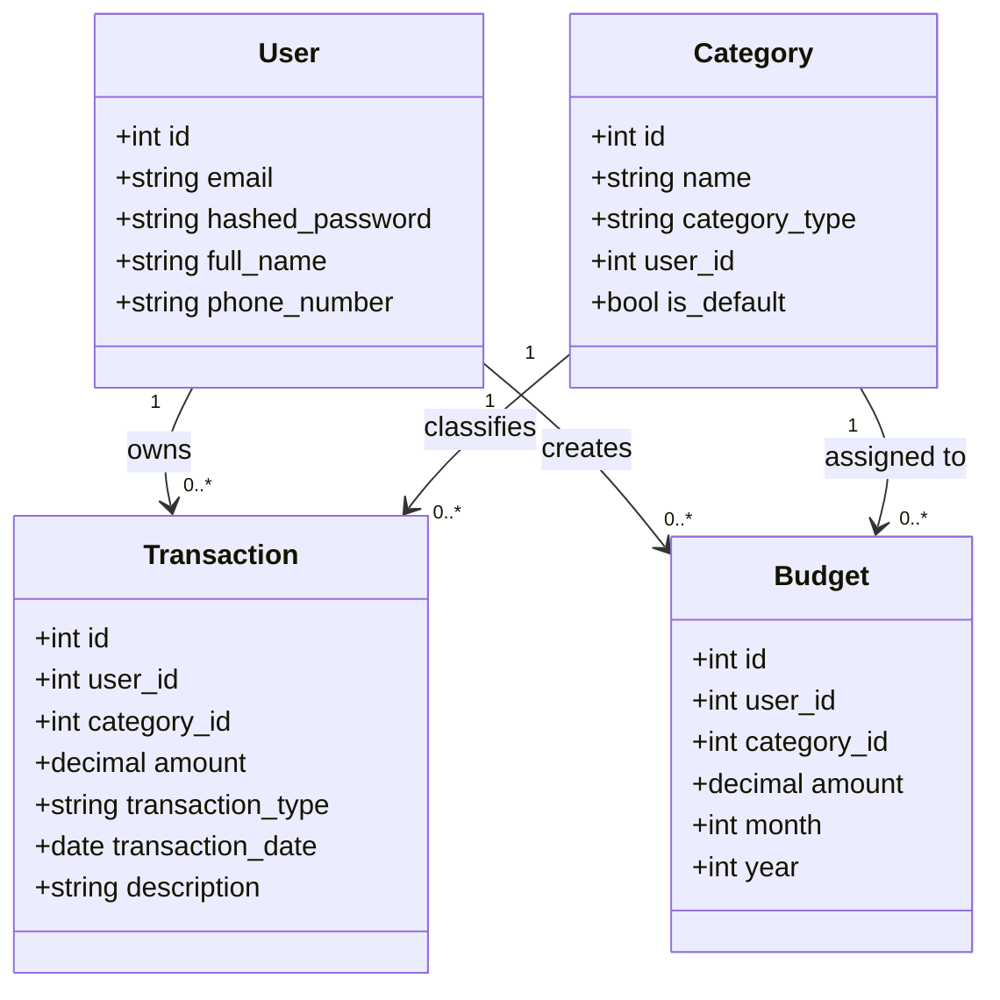
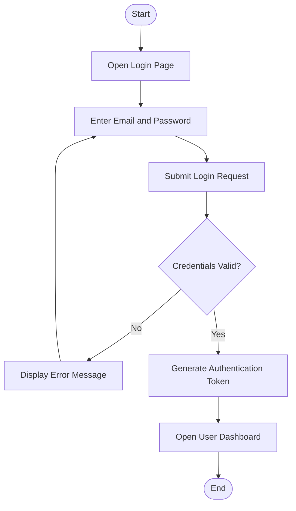
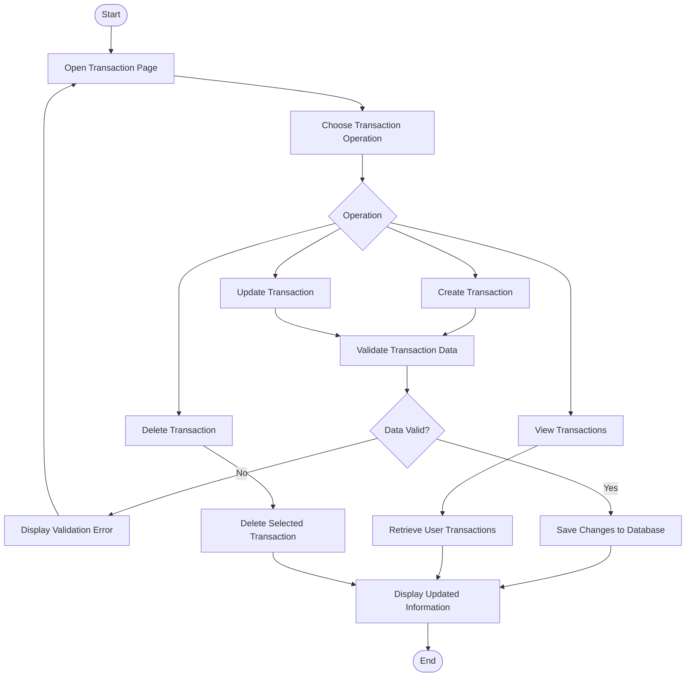
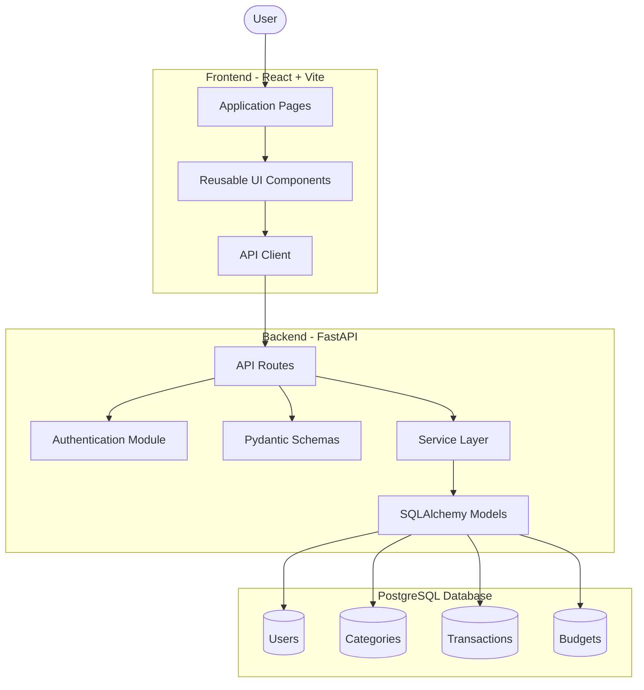
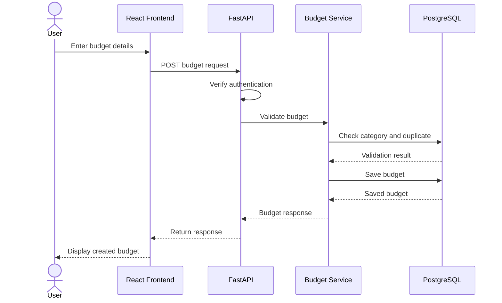
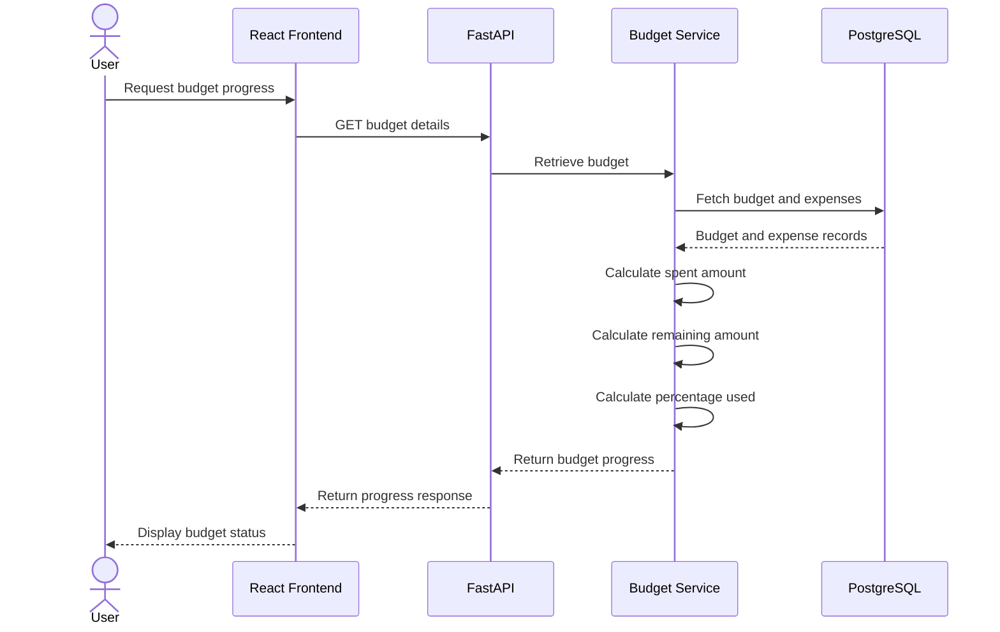

# FinPilot – UML Diagrams

**Project:** Smart Personal Finance & Expense Tracker with Budget Insights  
**Version:** 1.0  
**SDLC Model:** Incremental Model

---

## 1. Use Case Diagram

This diagram represents the interactions between a registered user and the FinPilot system.

**Explanation:** The registered user interacts with the system to manage personal financial information. Some use cases depend on features being completed in the final application.

---

## 2. Class Diagram

This diagram shows the main data entities and their relationships.

**Explanation:** A user can own multiple transactions and budgets. Categories classify transactions and are used to define budgets.

---

## 3. Activity Diagram – User Authentication

**Explanation:** The user enters login credentials. The backend validates the credentials and provides an authentication token when login succeeds.

---

## 4. Activity Diagram – Transaction Management

**Explanation:** Users can create, view, update, or delete transactions. The system validates submitted information before saving changes.

---

## 5. Component Diagram

This diagram shows the major software components and their dependencies.

**Explanation:** The frontend sends requests to backend API routes. The backend uses authentication, schemas, services, and SQLAlchemy models to process operations and communicate with PostgreSQL.

---

## 6. Sequence Diagram – Budget Creation

**Explanation:** The budget is validated, stored, and returned to the frontend after the request is authenticated.

---

## 7. Sequence Diagram – Budget Spending Calculation

**Explanation:** The budget service calculates spending progress using the expenses associated with the budget's category and period.

---

## 8. Diagram Summary

| Diagram | Purpose |
|---|---|
| Use Case Diagram | Shows user interactions with the system |
| Class Diagram | Shows entities and relationships |
| Activity Diagram – Authentication | Describes the login workflow |
| Activity Diagram – Transactions | Describes transaction operations |
| Component Diagram | Shows the application architecture |
| Sequence Diagram – Budget Creation | Shows budget creation interactions |
| Sequence Diagram – Budget Progress | Shows spending calculation interactions |

---

**Note:** These diagrams represent the intended logical design. Before final submission, verify class attributes, API operations, and frontend use cases against the final source code. Features not yet implemented should be labelled as planned rather than completed.

**End of UML Diagrams**
